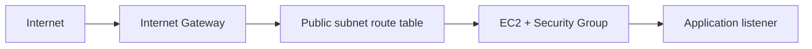

---
tags:
  - aws
  - vpc
  - ec2
---

# EC2 và VPC networking

Lỗi không truy cập được EC2 thường liên quan route table, security group, NACL, host firewall, listener hoặc DNS.

## Mô hình

Một subnet được xem là public khi route table có route phù hợp tới internet gateway; EC2 còn cần public IPv4/IPv6 hợp lệ và chính sách network cho phép nếu muốn truy cập trực tiếp từ Internet.

## Checklist

1. Kiểm tra VPC, subnet, route table, IGW/NAT và endpoint.
2. Kiểm tra inbound/outbound của Security Group, NACL (stateless).
3. Kiểm tra service listen `0.0.0.0` hoặc IP NIC, không chỉ `127.0.0.1`.
4. Kiểm tra reverse proxy, target group health và TLS.
5. Hạn chế SSH/RDP public; ưu tiên SSM Session Manager.

Nguồn: [Amazon VPC](https://docs.aws.amazon.com/vpc/latest/userguide/what-is-amazon-vpc.html).
