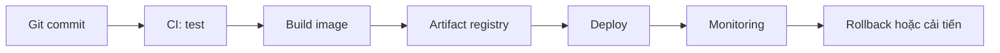

---
tags:
  - devops
  - roadmap
---

# Lộ trình học và triển khai DevOps

DevOps là tập hợp thực hành giúp đội phát triển **phát hành an toàn, thường xuyên và có khả năng khôi phục khi xảy ra sự cố**. Không có một công cụ đơn lẻ nào tạo thành DevOps.

## Thứ tự khuyến nghị

1. **Nền tảng:** Linux CLI, network, DNS, HTTP/TLS, Git.
2. **Đóng gói:** Dockerfile, image registry, Docker Compose.
3. **Tự động hóa:** CI, kiểm tra chất lượng, quản lý artifact, CD.
4. **Cloud & IaC:** IAM, VPC, Terraform, quản lý state.
5. **Điều phối:** Kubernetes và chiến lược rollout.
6. **Vận hành:** metrics, logs, traces, SLO, runbook và incident review.

## Bài thực hành đầu tiên

- Đóng gói một REST API với Docker.
- Sử dụng Compose để chạy API và PostgreSQL.
- Tạo pipeline chạy test trước khi build image.
- Định nghĩa quy trình rollback và kiểm tra health endpoint.

!!! tip "Ưu tiên thực hành có kết quả kiểm chứng"
    Mỗi bài nên có điều kiện đầu vào, lệnh thực hiện, dấu hiệu thành công, cách rollback và tài liệu chính thức.

**Đọc tiếp:** [Workstation](workstation.md) · [Docker Compose](../docker/compose.md) · [CI/CD](../ci-cd/fundamentals.md).
