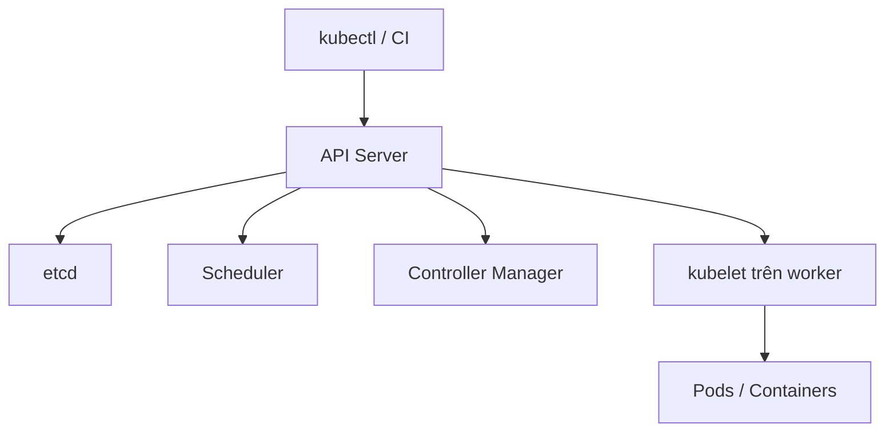

---
tags:
  - kubernetes
  - architecture
---


# Kubernetes: các thành phần quan trọng

**Control plane** quản lý desired state; **worker nodes** chạy workload trong Pod.



- **Pod:** đơn vị triển khai nhỏ nhất, có thể chứa nhiều container.
- **Deployment:** quản lý bản sao và rollout cho workload stateless.
- **Service:** địa chỉ/khả năng khám phá ổn định phía trước tập Pod.
- **Ingress/Gateway:** định tuyến traffic từ ngoài cluster (cần controller tương ứng).
- **ConfigMap/Secret:** cấu hình không nhạy cảm / dữ liệu nhạy cảm; Secret không mặc nhiên được mã hóa ở rest nếu cluster chưa bật encryption.

```bash
kubectl cluster-info
kubectl get nodes
kubectl get pods -A
```

Nguồn: [Kubernetes concepts](https://kubernetes.io/docs/concepts/).
