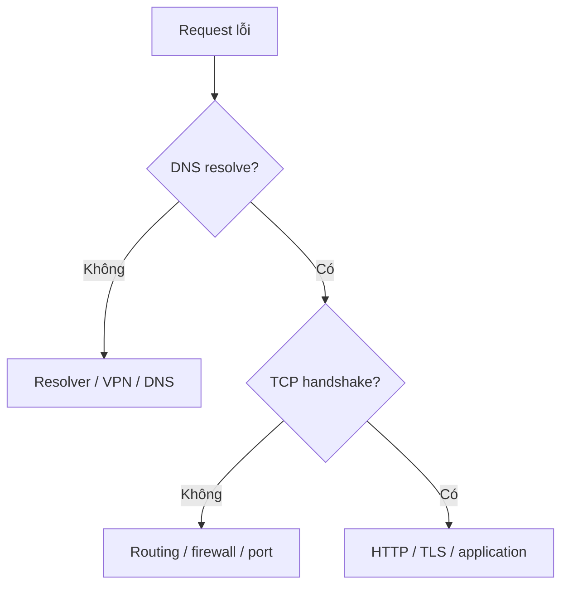

---
tags:
  - systemd
  - network
  - linux
---


# systemd và kiểm tra mạng

## Điều tra service

```bash
sudo systemctl status ssh --no-pager
sudo journalctl -u ssh -n 100 --no-pager
sudo systemctl is-enabled ssh
```

Lệnh trên là ví dụ khi **service SSH đã được cài**; tên unit phụ thuộc distribution.

## Phân tách DNS, TCP, HTTP

```bash
getent ahosts example.com
ip route
ss -lntp
curl -I --connect-timeout 5 https://example.com
```

Nếu DNS trả IP nhưng HTTP không kết nối được, điều tra routing, firewall, proxy, listener và TLS thay vì thay DNS ngay.



Đọc: [TCP, DNS, HTTP](../networking/fundamentals.md).
