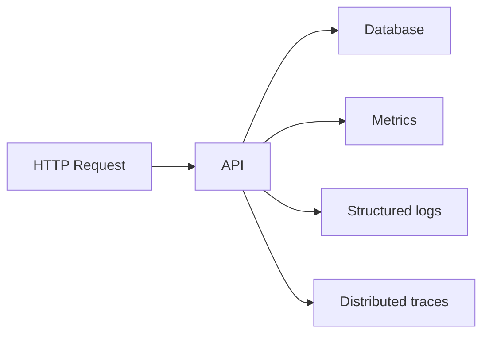

---
tags:
  - observability
  - metrics
  - logs
  - tracing
---

# Metrics, logs và traces

**Metrics** trả lời "đang xảy ra bao nhiêu/lâu đến mức nào"; **logs** ghi sự kiện chi tiết; **traces** cho thấy hành trình request qua nhiều service.

## Golden signals cho web service

- **Latency:** p50/p95/p99 của request thực tế.
- **Traffic:** requests/s và lưu lượng.
- **Errors:** error rate phân biệt lỗi client/server.
- **Saturation:** CPU, memory, connection pool, queue depth.

## Trường log thường dùng

`timestamp`, `level`, `service`, `environment`, `trace_id`, `request_id`, `message` — không log password, token, PII không cần thiết.

Nguồn: [OpenTelemetry concepts](https://opentelemetry.io/docs/concepts/).
